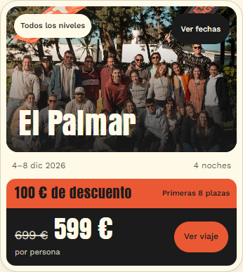

# Early bird en las cards de inicio · 25 de octubre de 2026

La implementación está terminada y validada localmente. El Studio tiene los campos desplegados y las tarifas están cargadas en siete borradores. La publicación de la web y de esos borradores queda pendiente por indicación expresa del usuario. Los ocho documentos publicados permanecen intactos y la web pública sigue sin promociones.

## Comportamiento implementado

- Card compacta en inicio: franja con «N € de descuento» y condición del cupo, precio general tachado, precio vigente y acción en la misma fila; fecha y duración comparten espacio. La foto sigue enlazando al viaje y las fechas conservan su interacción nativa.
- La disposición compacta se activa solo en inicio. Se conserva el consumidor compartido del catálogo y los viajes sin promoción.
- Cada salida de Sanity admite varios tramos, precio general y una sola tarifa activa. El editor cambia manualmente el tramo al agotarse el cupo; no hay un contador de reservas conectado.
- Se validan importes, cupos, solapamientos y capacidad. Los viajes completos o sin fechas no anuncian una promoción. La fecha mostrada corresponde a la tarifa elegida cuando hay varias salidas.
- Las señales fijas se conservan. Maldivas mantiene «Plazas limitadas», porque los PDF no concretan un número.

## Tarifas contrastadas

Se verificaron los SHA-256 de los ocho PDF originales y sus páginas comerciales. El inventario con nombres completos, hashes y referencias está en [salidas.json](../../sanity/2026-10-23/salidas.json). La tarifa inicial está activa en los borradores; los tramos posteriores quedan preparados para selección manual.

| Salida | General | Tramos con descuento | Fuente, página física |
| --- | ---: | --- | --- |
| Hossegor, 20/11/2026 | 399 € | Sin promoción | PDF 4, p. 10 |
| El Palmar, 04/12/2026 | 699 € | 599 € primeras 8; 649 € plazas 9–20 | PDF 5, p. 10 |
| Marruecos, 17/01/2027 | 899 € | 860 € primeras 5 | PDF 6, p. 11 |
| Marruecos, 24/01/2027 | 899 € | 860 € primeras 5 | PDF 7, p. 11 |
| Fuerteventura, 12/02/2027 | 699 € | 649 € primeras 4 | PDF 8, p. 9 |
| Senegal, 28/02/2027 | 1299 € | 1269 € primeras 5 | PDF 9, p. 12 |
| Maldivas, 21/03/2027 | 1499 € | 1399 €, plazas limitadas | PDF 10, p. 11 |
| Maldivas, 28/03/2027 | 1499 € | 1399 €, plazas limitadas | PDF 11, p. 11 |

En Marruecos se usa el importe de los PDF (860 €), no el precio ilustrativo del prototipo. La condición por primeras plazas sigue la indicación del usuario, sin aplicar la antigua fecha límite como regla automática.

## Validación y revisión

| Criterio | Evidencia |
| --- | --- |
| Compatibilidad del modelo, selección de tarifa, tramos, errores y consumidores sin promociones | 70/70 pruebas del árbol final; 64 pruebas de comportamiento afectadas; 256 combinaciones anteriores contrastadas por el revisor |
| Compilación y tipos del Studio | TypeScript aprobado; compilación de producción aprobada; esquema extraído y desplegado |
| Rutas y recursos del sitio | 24 páginas comprobadas tanto en `dist` con datos publicados como en la previsualización privada con descuentos |
| Diseño adaptable y navegación | 259 comprobaciones existentes en navegador y 130 específicas de promociones; anchos 320–1440, teclado, táctil, sin JavaScript, fechas largas y texto al 200 % |
| Card compacta | A 320 px, unos 379 px de alto (Fuerteventura 400 px por su título); precios en una línea, sin desbordamiento y acción de 44 px |
| Escritura segura en Sanity | Validación remota previa; creación atómica de siete borradores; revisión posterior de todos sus campos y de los ocho documentos publicados |

La primera ejecución de la base dio 66/67: fallaba una prueba del antiguo quiz por una exportación ausente. Durante el trabajo, otra tarea retiró esos archivos. El resultado final de 70/70 corresponde al árbol final compartido; la retirada del quiz no forma parte de este cambio.

Revisión independiente por `/root/review_early_bird`: contrastó fuentes originales, código, consumidores, hashes, pruebas, diseño y operación de borradores. Se corrigió un hallazgo sobre la selección del precio cuando coexistían una salida completa con precio y otra disponible sin precio. No quedan bloqueos identificados en el alcance revisado. Los detalles y el cierre de lectura remota están en [validation.json](evidence/validation.json).

## Estado de Sanity y publicación

- Proyecto `q5bj2rn2`, dataset `production`. [Studio desplegado](https://lets-surf-together.sanity.studio/), manteniendo su configuración de actualizaciones automáticas. El acceso a la interfaz alojada requiere autenticación; la publicación del esquema se verificó con el CLI y el registro remoto.
- Transacción de borradores: `5d64b709-ba04-45aa-a450-8e11c0162b3f`. Siete borradores creados, cero escrituras en documentos publicados. Solo se añaden promociones y se actualiza su explicación de precios; el resto de campos se cotejó con su origen.
- Lectura final: ocho documentos publicados sin promociones, siete borradores con siete ofertas activas y ninguna promoción en el snapshot público. [Recibo y estado remoto](evidence/remote-final.json).
- `dist` se reconstruyó desde los datos actualmente publicados. La versión local que contiene los descuentos se guarda en `artifacts/early-bird-2026-10-25/preview`; no está desplegada.
- Próximo paso cuando se autorice la publicación: desplegar el código de la web y después publicar los siete borradores desde Sanity. El webhook omite borradores. No se ejecutó publicación web ni `git commit` o `push`.

La gestión editorial está explicada en la [guía del cliente](../../guia-cliente.md). El script `scripts/update-trip-promotions.mjs` funciona por defecto como simulación, comprueba revisiones y rechaza conflictos con borradores; no debe ejecutarse con `--apply` mientras estos borradores estén pendientes. Si se decidiera descartar la operación, habría que revisar las revisiones actuales antes de eliminar únicamente estos borradores.

## Versión y alcance

Base Git: `58f338661fc4705364fea08727c836e79b3f2048`, rama `main`, cambios sin commit. El checkout ya contenía cambios ajenos de catálogo, niveles y otras páginas. Se conservaron; no se incluyeron en una publicación.

El [manifiesto de la candidata](evidence/version.json) identifica por SHA-256 los trece archivos de implementación revisados y sus snapshots de partida. Incluye cinco archivos nuevos: `scripts/trip-pricing.mjs`, `scripts/trip-pricing.d.mts`, `scripts/trip-pricing.test.mjs`, `scripts/update-trip-promotions.mjs` y `studio/schemaTypes/promotions.ts`. El [diff de esta tarea](evidence/task.patch) usa el punto de partida posterior a la extracción compartida del renderer, para conservar ese trabajo concurrente. Este informe, sus evidencias y capturas se añaden al cierre. Los HTML y snapshot generados en `dist` conviven con los cambios previos y se identifican aparte en el estado Git final.

Los registros completos, snapshots anterior/posterior, pruebas y previsualización están en `artifacts/early-bird-2026-10-25/`. Se conservaron solo como evidencia local. La implementación y la validación local están terminadas; el despliegue público está pendiente.

## Capturas de la candidata

